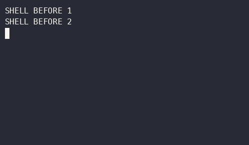

# Inline transcript

To run an editable three-row composer against local source:

```sh
dotnet run --project Examples/InlineTranscript
```

To generate 24 completed styled messages and exit, append `-- --demo`. Enter submits
the typed message; Escape ends the owning session and cancels pending producer output.
Each producer awaits insertion; terminal writes remain on the rendering thread.



The accompanying [cast](InlineTranscript.cast) was recorded in a macOS PTY with native
cursor-position replies and replayed into a history-aware terminal model. The numbered
messages and both preceding shell sentinels occur once and in order. The live composer
retains its reserved height. ConPTY and WinPTY bridge checks are recorded in
[VALIDATION.md](VALIDATION.md). Native conhost rendering, editing, Unicode paste,
history copying, resize recovery, and teardown checks also passed. Application
checks inside real Windows Terminal sessions passed at 100x45, 50x12, and 50x3.
Native Windows Terminal GUI checks also passed: live rendering during insertion,
native scrollback and Select All/copy, physical keyboard editing during output,
paste, maximize/restore, and Escape with pending output. Windows console input
replaces non-BMP characters, such as emoji, with U+FFFD before the ANSI driver
reads them; see [validation details](VALIDATION.md#native-windows-terminal-gui-checks-2026-10-15).

## Windows Terminal and conhost checks

The automated ConPTY and WinPTY checks validate output streams and a terminal
history model. An interactive pass in classic conhost also passed on Windows
ARM64; see [validation details](VALIDATION.md#native-conhost-checks-2026-10-15).
Windows Terminal application-level and
[native GUI](VALIDATION.md#native-windows-terminal-gui-checks-2026-10-15) results
are recorded separately. To repeat the native checks, follow the steps below in
each host. Launch with `NO_COLOR` unset; when it is set, Terminal.Gui uses
16-color output by design.

To check Windows Terminal, run these PowerShell commands from the repository root:

```powershell
Write-Output 'SHELL BEFORE 1'
Write-Output 'SHELL BEFORE 2'
dotnet run --project Examples/InlineTranscript -c Release --no-build -- --demo
Write-Output 'SHELL AFTER'
```

To check classic conhost, repeat in a shell window hosted by conhost. A Command
Prompt tab inside Windows Terminal still tests the Windows Terminal host.

1. Observe the composer while messages print. It should remain readable at its
   reserved three-row height, with completed lines above it.
2. After exit, scroll back and verify the two preceding shell sentinels,
   messages `000` through `023`, and the following sentinel appear once and in
   order. Select and copy completed text to verify native scrollback copying.
3. To check editing, rerun without `--demo`. Enter text, move the caret with
   arrow and modified-arrow keys, paste a single line, and press Enter. Verify
   the submitted text prints once and the input clears. Include wide and
   combining characters to check the host's font and cell-width agreement.
4. Press Escape and verify prompt, cursor, and keyboard behavior return to
   normal. Also repeat the demo and press Escape while messages are pending;
   it should exit promptly.
5. To check resize recovery, resize while the app is active and verify the
   composer remains usable and exits cleanly. Resizing currently clears and
   resets the live region; preservation of visible output across resize is a
   follow-up feature.

## Unix PTY/history checks

To reproduce the Unix PTY/history check after building Release:

```sh
python3 -m venv /tmp/inline-verify
/tmp/inline-verify/bin/pip install pyte
/tmp/inline-verify/bin/python Scripts/tuirec/verify-inline-output.py --cast /tmp/inline.cast
/tmp/inline-verify/bin/python Scripts/tuirec/verify-inline-output.py --rows 3
/tmp/inline-verify/bin/python Scripts/tuirec/verify-inline-output.py --redirect-stdout
```

To record using `tuirec`, follow [the recording guide](../../Scripts/tuirec/README.md).
An unattended recorder that does not answer CPR cannot verify preservation of prior
shell output: the documented missing-CPR fallback uses row zero. Use the history check
above for that assertion. Real terminal width and resize reflow may differ from the model.
